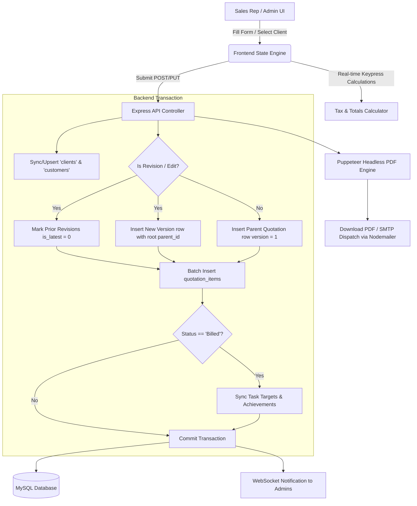
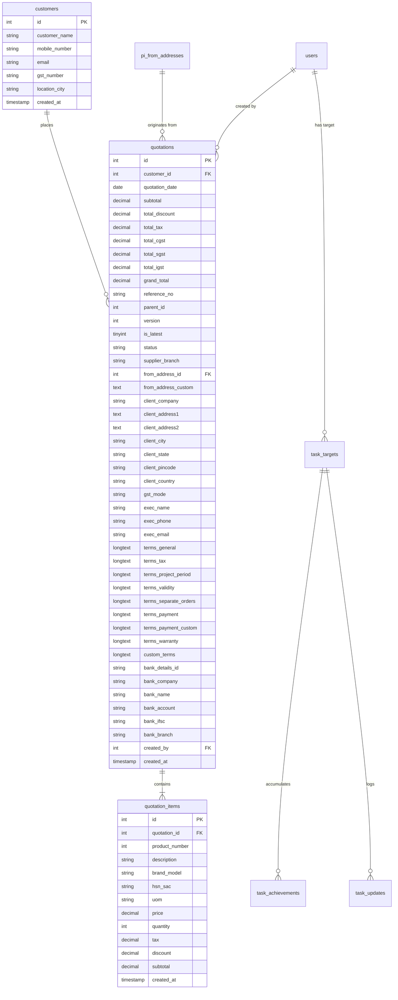
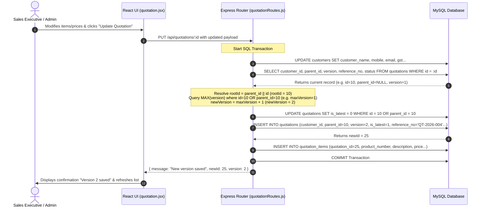
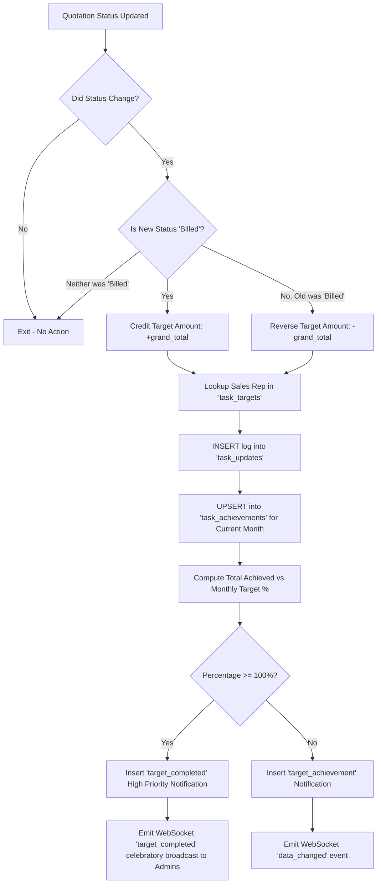

# ACHME CRM — Quotation Module: Complete Technical & Business Logic Specification

This document provides a comprehensive, deep-dive specification of the **Quotation System** in ACHME CRM. It details how the module functions end-to-end, all data structures, user input requirements, calculation engines, version control logic, automated target synchronization, and document template rendering rules.

---

## Table of Contents
1. [System Architecture & Core Workflow](#1-system-architecture--core-workflow)
2. [Database Schema & Data Model](#2-database-schema--data-model)
3. [Field Inventory & User Input Requirements](#3-field-inventory--user-input-requirements)
   - [3.1 Header & Supplier Information (From Address)](#31-header--supplier-information-from-address)
   - [3.2 Customer & Billing Information (Billed To)](#32-customer--billing-information-billed-to)
   - [3.3 Quotation Metadata & Document Control](#33-quotation-metadata--document-control)
   - [3.4 Line Items (Quote Items)](#34-line-items-quote-items)
   - [3.5 Account Executive Details](#35-account-executive-details)
   - [3.6 Terms & Conditions Configuration](#36-terms--conditions-configuration)
   - [3.7 Bank Details Configuration](#37-bank-details-configuration)
   - [3.8 Attached Media / Image Uploads](#38-attached-media--image-uploads)
4. [Mathematical & Business Calculation Engine](#4-mathematical--business-calculation-engine)
   - [4.1 Geographic GST Routing (Intra-state vs Inter-state)](#41-geographic-gst-routing-intra-state-vs-inter-state)
   - [4.2 Multi-Mode GST Calculations (Exclusive, Inclusive, Exempt, Tax Extra)](#42-multi-mode-gst-calculations-exclusive-inclusive-exempt-tax-extra)
   - [4.3 Multi-Tax Rate Aggregation & Grouping](#43-multi-tax-rate-aggregation--grouping)
   - [4.4 Currency to Indian Rupee Words Conversion](#44-currency-to-indian-rupee-words-conversion)
5. [Immutable Version Control & Revision History Logic](#5-immutable-version-control--revision-history-logic)
6. [Quotation Lifecycle & Automated Target Synchronization](#6-quotation-lifecycle--automated-target-synchronization)
7. [Document Rendering & PDF Generation Logic](#7-document-rendering--pdf-generation-logic)
8. [Security, Authentication & Role-Based Access Control (RBAC)](#8-security-authentication--role-based-access-control-rbac)
9. [REST API Contracts & Endpoints](#9-rest-api-contracts--endpoints)

---

## 1. System Architecture & Core Workflow

The Quotation Module handles the creation, mathematical evaluation, versioning, PDF generation, email dispatch, and sales performance tracking of B2B sales proposals.



### Core Workflow Steps:
1. **Client Identification**: User either enters raw customer details or selects an existing client via `ClientSearchDropdown`. Selecting a client auto-populates billing addresses, state, GSTIN, and company phone/email.
2. **Itemized Quote Formulation**: User enters line items with descriptions, model names, quantities, unit prices, individual tax percentages, and flat discounts.
3. **Configuration of Commercial Terms**: User selects the supplying branch (Coimbatore, Bangalore, Chennai), bank account, GST mode, project completion timeline, payment terms, and warranty.
4. **Instant Calculation**: The client-side engine computes line subtotals, tax splits (CGST/SGST vs IGST based on supplier vs client state), overall discount, and grand totals on every keystroke.
5. **Persistence & Versioning**: Upon saving, a database transaction creates/updates the customer records and inserts the quotation. If editing an existing quote, a new version is created while preserving complete audit history.
6. **Performance / Target Sync**: When a quote is moved to `Billed` status, the system automatically credits the sales executive's monthly performance target in the CRM target engine.
7. **Document Generation & Dispatch**: Generates a standardized, printable A4 PDF matching corporate identity, with options to download directly or email to the client using logged-in user SMTP credentials.

---

## 2. Database Schema & Data Model

The Quotation module interacts with 5 core tables and 4 auxiliary target/notification tables:



---

## 3. Field Inventory & User Input Requirements

### 3.1 Header & Supplier Information (From Address)
Controls the origin company entity and legal GST details rendered at the top left of the quote.

| Field Name | Type | UI Control | Required? | Source / Logic |
| :--- | :--- | :--- | :---: | :--- |
| `supplier_branch` | `VARCHAR(100)` | Dropdown | **Yes** | Options: `Coimbatore`, `Bangalore`, `Chennai`. Drives supplier state resolution and branch address defaults. |
| `from_address_custom` | `TEXT` | Auto-filled / Text | Optional | Contains resolved multi-line address, phone, email, and supplier GSTIN. |
| `from_address_id` | `INT` | Dropdown | Optional | ID from `pi_from_addresses` table if a custom warehouse/office address is selected. |
| `from_gstin` | `VARCHAR(20)` | Derived | Auto | Coimbatore: `33AAHFA7876M1ZX`<br>Bangalore: `29AAHFA7876M1ZM`<br>Chennai: `33AAHFA7876M1ZX` |

---

### 3.2 Customer & Billing Information (Billed To)
Controls customer identification, cross-module CRM sync, and geographical tax routing.

| Field Name | Type | UI Control | Required? | Validation & Logic |
| :--- | :--- | :--- | :---: | :--- |
| `salutation` | `VARCHAR(10)` | Dropdown | Optional | Options: `Mr.`, `Mrs.`, `M/S.`. Prefixed to customer name. |
| `customer_name` | `VARCHAR(150)` | Auto-complete Input | **REQUIRED** | Customer/Contact person name. Supports lookup from existing clients. |
| `mobile_number` | `VARCHAR(20)` | Numeric Input | **REQUIRED** | Max 13 digits (numeric regex `^\d{0,13}$`). Used as unique key to lookup/upsert into `clients` directory. |
| `email` | `VARCHAR(150)` | Email Input | Optional | Valid email format. Default recipient when sending quotation via SMTP. |
| `gst_number` | `VARCHAR(20)` | Text (Uppercase) | Optional | Format: `33AAAAA0000A1Z5`. **Smart Logic**: Entering the first 2 digits automatically parses the State Code map and auto-selects `client_state`. |
| `client_company` | `VARCHAR(150)` | Auto-complete / Input | Optional | Registered company name. If present, rendered in bold as primary billing recipient in the PDF. |
| `client_address1` | `TEXT` | Text Input | Optional | Primary street address / building details. |
| `client_address2` | `TEXT` | Text Input | Optional | Area / landmark details. |
| `client_city` | `VARCHAR(100)` | Text Input | Optional | City / District. |
| `client_state` | `VARCHAR(100)` | Dropdown | Optional | 36 Indian States/UTs. **Crucial**: Determines intra-state vs inter-state GST split. |
| `client_pincode` | `VARCHAR(10)` | Numeric Input | Optional | Max 6 digits (`^\d{0,6}$`). |
| `client_country` | `VARCHAR(50)` | Readonly Text | Optional | Defaults to `"India"`. |

---

### 3.3 Quotation Metadata & Document Control

| Field Name | Type | UI Control | Required? | Source / Logic |
| :--- | :--- | :--- | :---: | :--- |
| `quotation_date` | `DATE` | Datepicker | **REQUIRED** | Defaults to today's date (`YYYY-MM-DD`). |
| `reference_no` | `VARCHAR(50)` | System Generated | Auto | Unique identifier format: `QT-YYYYMMDD-XXXX` (e.g., `QT-20260613-4821`). |
| `docNumber` (Display) | Display Only | Calculated | Auto | Rendered in PDF/UI as `QT-YYYY-XXX` (e.g., `QT-2026-004`). |
| `version` | `INT` | Integer Badge | Auto | Starts at `1`. Increments on every revision (`version + 1`). |
| `is_latest` | `TINYINT(1)` | Flag | Auto | `1` for the active version; `0` for archived revisions. |
| `parent_id` | `INT` | FK Reference | Auto | `NULL` for original quote; points to the root quotation ID for all subsequent revisions. |
| `status` | `VARCHAR(50)` | Dropdown / Badge | Optional | Default: `Pending`. Options: `Send`, `Pending`, `Close`, `Billed`, `Cancel`. |

---

### 3.4 Line Items (Quote Items)
Each quotation contains one or more line items stored in `quotation_items`.

| Field Name | Type | UI Control | Required? | Validation & Display Rules |
| :--- | :--- | :--- | :---: | :--- |
| `product_number` | `INT` | Sequenced index | Auto | Line sequence order (1, 2, 3...). |
| `description` | `TEXT` | Textarea / Input | **REQUIRED** | **Special Formatting Rule**: If text contains a comma (`,`), the text *before* the first comma is styled as **Bold Header** (`font-weight: 700`, color `#1e293b`), and text *after* the comma is rendered as subtext/metadata (`color: #64748b`, `font-size: 10.5px`). |
| `brand_model` | `VARCHAR(150)` | Text Input | Optional | Brand or model (e.g. *Hikvision 4MP*, *Dell PowerEdge*). Column is auto-hidden in PDF if all items leave it empty. |
| `hsn_sac` | `VARCHAR(20)` | Text Input | Optional | HSN/SAC code (e.g. `8525`, `9987`). Column is auto-hidden in PDF if all items leave it empty. |
| `uom` | `VARCHAR(20)` | Dropdown / Custom | Optional | Options: `Nos`, `Units`, `Pieces`, `Boxes`, `Sets`, `Meters`, `Kg`, `Liters`, or custom string. Defaults to `Nos`. |
| `price` | `DECIMAL(10,2)` | Numeric Input | **REQUIRED** | Unit price. Must be $\ge 0$. |
| `quantity` | `INT` | Numeric Input | **REQUIRED** | Quantity. Must be $\ge 1$. |
| `tax` | `DECIMAL(10,2)` | Numeric Input | Optional | GST rate percentage for this specific item (e.g., `18.00`, `28.00`, `5.00`). Defaults to `18`. |
| `discount` | `DECIMAL(10,2)` | Numeric Input | Optional | Flat deduction amount (₹) applied directly to this line item. |
| `subtotal` | `DECIMAL(10,2)` | Calculated | Auto | Final calculated total value of this line item. |

---

### 3.5 Account Executive Details
Captures the sales representative handling the deal.

| Field Name | Type | UI Control | Logic & Default Value |
| :--- | :--- | :--- | :--- |
| `exec_name` | `VARCHAR(100)` | Text Input | Auto-populated from logged-in user profile (`first_name + last_name`). Editable. |
| `exec_phone` | `VARCHAR(20)` | Text Input | Auto-populated from logged-in user's mobile number. Editable. |
| `exec_email` | `VARCHAR(150)` | Email Input | Auto-populated from logged-in user's email. Editable. |

---

### 3.6 Terms & Conditions Configuration
Enables toggling and customizing standard commercial, legal, and operational terms.

| Field Name | Type | UI Control | Options / Logic |
| :--- | :--- | :--- | :--- |
| `terms_general` | `BOOLEAN / LONGTEXT` | Checkbox | Standard T&C clause toggle. |
| `custom_terms` | `LONGTEXT` | Text Input | Free-form additional notes or conditions entered by the sales representative. |
| `gst_mode` | `VARCHAR(20)` | Radio Selector | Options: `Exclusive`, `Inclusive`, `Exempt`, `Tax Extra`. Drives the tax calculation logic and printed tax disclaimer term. |
| `hide_gst_percentage` | `BOOLEAN` | Checkbox (in `terms_separate_orders`) | When checked, hides the specific rate percentage (e.g., displays `CGST` instead of `CGST 9%`). |
| `terms_project_period`| `LONGTEXT` | Text Input | Preset: `"30-60 days from Purchase Order date"`. Editable. |
| `terms_validity` | `LONGTEXT` | Radio Selector | Options: `2 days`, `5 days`, `10 days`, `15 days`, `30 days`. Prints quote validity. |
| `terms_payment` | `LONGTEXT` | Radio Selector | Options: `100% Advance`, `Payment Against Delivery`, `15 Days`, `30 Days`, `45 Days`, `Custom`. |
| `terms_payment_custom`| `LONGTEXT` | Numeric / Text Input | Used when `terms_payment === 'Custom'` to specify exact custom days or milestones. |
| `terms_warranty` | `LONGTEXT` | Radio Selector | Options: `No Warranty`, `Testing Warranty`, `1 Month`, `3 Months`, `6 Months`, `12 Months`, `24 Months`, `36 Months`, `OEM Warranty`, `Supplier Warranty`, `OEM Hardware Warranty`, `No Software Warranty`. |
| `terms_separate_orders`| `LONGTEXT (JSON)` | Multi-checkbox | Stores boolean flags: `{ material: bool, installation: bool, usd: bool, boq: bool, hide_gst_percentage: bool, attached_images: [] }`. |

---

### 3.7 Bank Details Configuration
Specifies the supplier banking credentials printed on the quotation for wire transfer/NEFT/RTGS.

| Field Name | Type | UI Control | Options / Logic |
| :--- | :--- | :--- | :--- |
| `bank_details_id` | `VARCHAR(50)` | Dropdown | Options: `hdfc`, `kotak`. Selecting a bank auto-populates the account details. |
| `bank_company` | `VARCHAR(150)` | Text Input | Default: `"ACHME COMMUNICATION"`. |
| `bank_name` | `VARCHAR(100)` | Text Input | Default: `"HDFC BANK"` / `"KOTAK MAHINDRA BANK"`. |
| `bank_account` | `VARCHAR(50)` | Text Input | Default: `"00312320005822"`. |
| `bank_ifsc` | `VARCHAR(50)` | Text Input (Uppercase)| Default: `"HDFC0000031"`. |
| `bank_branch` | `VARCHAR(100)` | Text Input | Default: `"Coimbatore"`. |

---

### 3.8 Attached Media / Image Uploads
- Allows attaching up to **3 reference images / technical diagrams**.
- **Client-side Processing**: File is intercepted via HTML file input, processed using HTML5 `<canvas>`, downscaled if exceeding 1200px dimension, and compressed to JPEG quality `0.75` base64 string.
- Stored directly in the quotation JSON structure inside `terms_separate_orders.attached_images`.

---

## 4. Mathematical & Business Calculation Engine

### 4.1 Geographic GST Routing (Intra-state vs Inter-state)

The system compares the supplier's state against the client's state to determine whether tax is split into CGST + SGST (Intra-state) or levied as IGST (Inter-state).

1. **Supplier State Resolution**:
   - `Coimbatore` $\rightarrow$ `Tamil Nadu`
   - `Chennai` $\rightarrow$ `Tamil Nadu`
   - `Bangalore` $\rightarrow$ `Karnataka`
2. **Client State Resolution**: `client_state` (normalized to lowercase, trimmed).
3. **Routing Formula**:
   $$\text{isSameState} = (\text{Supplier State} == \text{Client State}) \land (\text{Client State} \neq \text{""})$$
   - If $\text{isSameState} = \text{true}$:
     $$\text{CGST Rate} = \frac{T_i}{2}, \quad \text{SGST Rate} = \frac{T_i}{2}, \quad \text{IGST Rate} = 0$$
   - If $\text{isSameState} = \text{false}$:
     $$\text{CGST Rate} = 0, \quad \text{SGST Rate} = 0, \quad \text{IGST Rate} = T_i$$

---

### 4.2 Multi-Mode GST Calculations

For each item $i$:
- $P_i$ = Unit Price
- $Q_i$ = Quantity
- $D_i$ = Discount Amount (flat ₹ deduction)
- $T_i$ = Item GST Percentage (e.g. $18$)
- $\text{Base}_i = P_i \times Q_i$
- $\text{Net Base}_i = \text{Base}_i - D_i$

#### Mode 1: Exclusive Mode (GST added on top of entered price)
$$\text{Taxable Value}_i = \text{Net Base}_i$$
$$\text{Tax Amount}_i = \text{Taxable Value}_i \times \frac{T_i}{100}$$
$$\text{Line Total}_i = \text{Taxable Value}_i + \text{Tax Amount}_i$$
$$\text{Grand Total} = \sum \text{Taxable Value}_i + \sum \text{Tax Amount}_i$$

#### Mode 2: Inclusive Mode (Entered price already includes GST)
$$\text{Taxable Value}_i = \frac{\text{Net Base}_i}{1 + \frac{T_i}{100}}$$
$$\text{Tax Amount}_i = \text{Net Base}_i - \text{Taxable Value}_i$$
$$\text{Line Total}_i = \text{Net Base}_i$$
$$\text{Grand Total} = \sum \text{Net Base}_i$$
*(In the summary box, the displayed Subtotal is the back-calculated Taxable Value, with GST shown separately, totaling the exact entered Net Price).*

#### Mode 3: Exempt Mode & Tax Extra Mode (No tax computed in totals)
$$\text{Taxable Value}_i = \text{Net Base}_i$$
$$\text{Tax Amount}_i = 0$$
$$\text{Line Total}_i = \text{Net Base}_i$$
$$\text{Grand Total} = \sum \text{Net Base}_i$$

---

### 4.3 Multi-Tax Rate Aggregation & Grouping

When a quotation contains items with different tax rates (e.g. Item 1 at 18%, Item 2 at 28%, Item 3 at 5%):
1. The engine buckets taxable amounts by tax rate:
   $$\text{Bucket}(T) = \sum_{i \in \text{Items with rate } T} \text{Tax Amount}_i$$
2. In the Summary Box, the engine outputs separate breakdown rows sorted by tax rate descending:
   - Intra-state: Outputs `CGST (T/2)%` and `SGST (T/2)%` for each distinct rate.
   - Inter-state: Outputs `IGST T%` for each distinct rate.
3. If `hide_gst_percentage` is toggled on, rate labels are stripped (outputting consolidated `CGST`, `SGST`, `IGST`).

---

### 4.4 Currency to Indian Rupee Words Conversion

The system formats `grand_total` into official Indian Numbering words (Lakhs, Crores):
- Rule: $10,000,000 \rightarrow \text{"Crore"}$, $100,000 \rightarrow \text{"Lakh"}$, $1,000 \rightarrow \text{"Thousand"}$, $100 \rightarrow \text{"Hundred"}$.
- Suffix: Always appends `" Rupees Only"`.
- Example: ₹ 1,84,500.00 $\rightarrow$ *"One Lakh Eighty Four Thousand Five Hundred Rupees Only"*.

---

## 5. Immutable Version Control & Revision History Logic

To preserve compliance and auditing integrity, **editing a quotation never overwrites existing database rows**.



### Key Versioning Rules:
- The active quote in the main quotation list is always the row where `is_latest = 1`.
- Historical versions remain in the database with `is_latest = 0`.
- Calling `GET /api/quotations/customer-history/:id` queries the entire lineage tree (`parent_id = rootId OR id = rootId`) and returns all historical revisions ordered by version number.
- Older versions can be viewed or printed in exact historical state, but cannot overwrite the tree.

---

## 6. Quotation Lifecycle & Automated Target Synchronization

### Status States:
1. `Send`: Proposal dispatched to client.
2. `Pending`: Under review / awaiting customer confirmation (Default).
3. `Close`: Deal lost or closed without order.
4. `Billed`: Order confirmed and converted into active business.
5. `Cancel`: Quotation voided.

### Automated Sales Target Synchronization (`handleQuotationTargetSync`)
When a quotation's status transitions:



---

## 7. Document Rendering & PDF Generation Logic

The quotation template engine (`invoicetemplate.jsx` and `generateInvoicePdf.js`) enforces strict A4 print formatting rules:

1. **Header Section**:
   - Company logo displayed top-left (`achme logo`).
   - Uppercase document title (`QUOTATION` / `PROPOSAL`).
   - Document ID Badge: Doc No (`QT-YYYY-XXX`) and Date (`DD MMM YYYY`).
2. **Top Grid (From & Billed To)**:
   - 2-column equal-height card layout (`.ft-top-boxes`).
   - Supplier card displays branch address, GSTIN, and branch phone numbers.
   - Client card displays Company Name (bold), Contact Person Name, GSTIN, combined address, phone (`+91` prefixed), and email.
3. **Items Table**:
   - Headers: `S.NO`, `BRAND`, `DESCRIPTION`, `HSN/SAC`, `QTY`, `UNIT PRICE`, `UOM`, `GST%`, `TOTAL VALUE`.
   - **Dynamic Column Hiding**: If no item in the list has a `brand_model`, the `BRAND` column is omitted entirely. If no item has `hsn_sac`, the `HSN/SAC` column is omitted.
4. **Mid-Section 2×2 Grid**:
   - **Top Left**: Terms & Conditions card (auto-generates clauses from T&C toggles).
   - **Top Right**: Summary card (Subtotal, Discount, CGST/SGST/IGST breakdown, Grand Total, and italicized Amount in Words).
   - **Bottom Left**: Important Notes card (Standard project exclusions, BoQ variation, and civil work exclusions).
   - **Bottom Right**: Bank Details card (Company, Bank Name, Account Number, IFSC, Branch).
5. **Image Attachments Gallery**:
   - Rendered below the mid-section if 1, 2, or 3 images are attached.
   - 1 Image: Full-width centered container.
   - 2 Images: 2-column side-by-side grid.
   - 3 Images: 1 large top banner + 2 bottom split images.
6. **Bottom Pinned Footer**:
   - Executive Bar: Pinned horizontal bar showing `Executive Name | PH | Email`.
   - Our Branches Box: Lists other branch locations and GSTIN numbers (automatically filters out the current supplying branch to avoid redundancy).
7. **Puppeteer Multi-page Print Engine**:
   - Uses Chrome in headless mode with `@page { size: A4 portrait; margin: 8mm 8mm 12mm 8mm; }`.
   - Applies `page-break-inside: avoid; break-inside: avoid;` on all cards, table rows, and bank boxes to prevent awkward mid-card page splits.

---

## 8. Security, Authentication & Role-Based Access Control (RBAC)

All Quotation API routes require a verified JWT Bearer Token (`verifyToken` middleware).

### Role Permissions Matrix:

| Action | Admin | Subadmin | Employee |
| :--- | :---: | :---: | :---: |
| **View All Quotations** | Yes | Yes | No (Only quotations created by self or shared via `client_shares`) |
| **Create Quotation** | Yes | Yes | Yes |
| **Edit / Revise Quotation** | Yes | Yes | Yes (Only quotes created by self) |
| **Change Status** | Yes | Yes | Yes (Only quotes created by self) |
| **Delete Quotation / Version** | Yes | No | No (Admin only) |
| **Send Email via SMTP** | Yes | Yes | Yes (Dispatched via employee's configured SMTP) |
| **Download PDF** | Yes | Yes | Yes |

### Client-Sharing Data Access for Employees:
Employees can access quotations if:
1. `q.created_by = req.user.id`, OR
2. The quotation's customer is linked to a client record shared with the employee via the `client_shares` table:
   ```sql
   q.customer_id IN (
     SELECT cust.id FROM customers cust
     JOIN clients cl ON (cl.phone = cust.mobile_number OR cl.email = cust.email)
     WHERE cl.id IN (
       SELECT client_id FROM client_shares
       WHERE shared_to IN (SELECT id FROM teammember WHERE user_id = ?)
     )
   )
   ```

---

## 9. REST API Contracts & Endpoints

| Method | Endpoint | Access | Description |
| :--- | :--- | :--- | :--- |
| `GET` | `/api/quotations` | Authenticated | Fetches all active latest quotations (`is_latest = 1`). Filtered by employee role if applicable. |
| `GET` | `/api/quotations/:id` | Authenticated | Fetches full quotation details including joined line items, customer profile, and branch info. |
| `GET` | `/api/quotations/customer-history/:id` | Authenticated | Fetches all revision history rows belonging to the quotation's version tree. |
| `POST`| `/api/quotations/create` | Authenticated | Creates a new customer (if needed), clients sync, and parent quotation with line items. |
| `PUT` | `/api/quotations/:id` | Authenticated | Creates a new immutable revision (`version + 1`), sets prior versions `is_latest = 0`. |
| `PATCH`| `/api/quotations/:id` | Authenticated | Updates quotation status (`Pending`, `Send`, `Billed`, etc.) and triggers target sync. |
| `DELETE`| `/api/quotations/:id` | **Admin Only** | Deletes a quotation and cascades delete to `quotation_items`. |
| `GET` | `/api/quotations/download-pdf/:id` | Authenticated | Streams a dynamically generated Puppeteer A4 PDF. |
| `POST`| `/api/quotations/send-email/:id` | Authenticated | Sends quotation email with PDF attachment using the user's SMTP credentials. |
| `GET` | `/api/quotations/from-addresses` | Authenticated | Lists all saved custom office/warehouse sender addresses. |
| `POST`| `/api/quotations/from-addresses` | Authenticated | Creates a new custom sender address. |
| `DELETE`| `/api/quotations/from-addresses/:id` | **Admin Only** | Deletes a sender address. |

---
*Document generated for ACHME CRM engineering specification and business logic implementation.*
