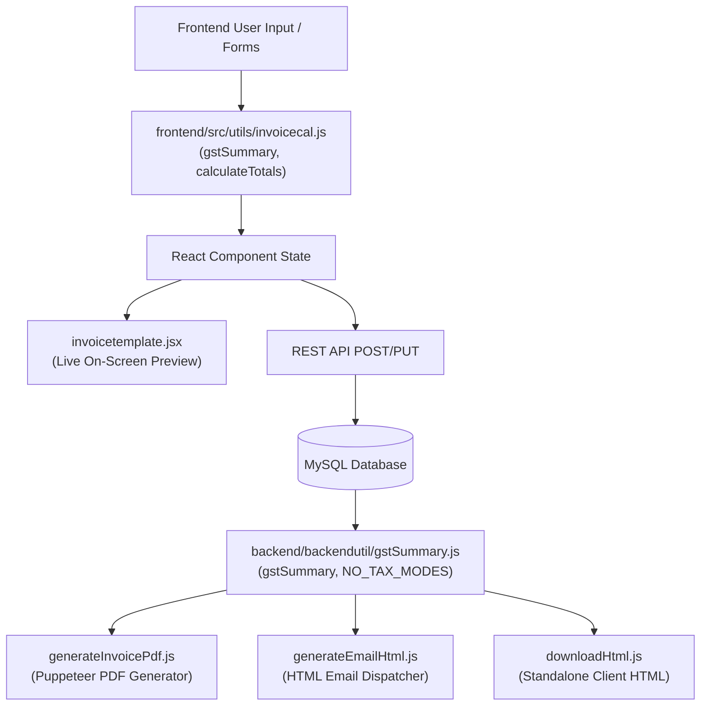
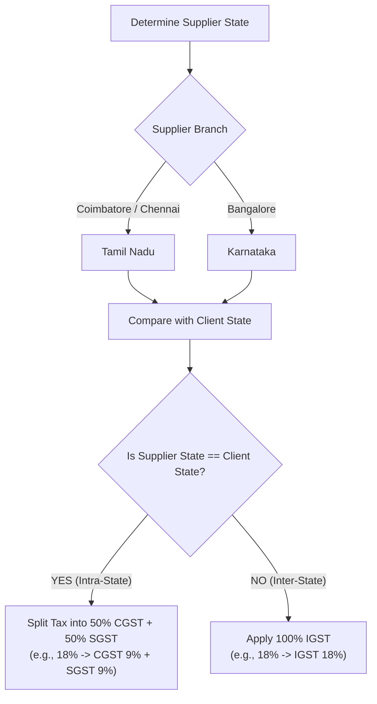

# ACHME CRM: Complete Tax & GST Calculation Specification (`tax.md`)

This specification provides the comprehensive, authoritative guide to how taxes (GST, CGST, SGST, IGST, Custom Tax, and No-Tax modes) are calculated, stored, displayed, and rendered across all documents (Quotations, Proforma Invoices, Estimations, Service Estimations, PDF Downloads, and Email Notifications) in ACHME CRM.

---

## Table of Contents
1. [Architecture & Single Source of Truth](#1-architecture--single-source-of-truth)
2. [Tax Rates & Tax Types](#2-tax-rates--tax-types)
3. [Tax Modes & Mathematical Logic](#3-tax-modes--mathematical-logic)
   - [Mode 1: Exclusive (Tax Added on Top)](#mode-1-exclusive-tax-added-on-top)
   - [Mode 2: Inclusive (Tax Included in Price)](#mode-2-inclusive-tax-included-in-price)
   - [Mode 3: Exempt (Tax Exempt / SEZ NIL Tax)](#mode-3-exempt-tax-exempt--sez-nil-tax)
   - [Mode 4: Tax Extra (Terms Disclaimer Mode)](#mode-4-tax-extra-terms-disclaimer-mode)
   - [Mode 5: Without GST (NONE / 0% Tax)](#mode-5-without-gst-none--0-tax)
4. [Intra-State vs Inter-State Tax Routing (CGST / SGST vs IGST)](#4-intra-state-vs-inter-state-tax-routing-cgst--sgst-vs-igst)
5. [Display & Visibility Rules (Showing & Hiding Tax)](#5-display--visibility-rules-showing--hiding-tax)
   - [Not Show GST % Option (`hide_gst_percentage`)](#not-show-gst--option-hide_gst_percentage)
   - [Item Table Column Visibility (`GST%`)](#item-table-column-visibility-gst)
   - [Summary Box Breakdown & Multi-Rate Grouping](#summary-box-breakdown--multi-rate-grouping)
   - [Amount in Words Generation](#amount-in-words-generation)
   - [Dynamic Terms & Conditions Generation](#dynamic-terms--conditions-generation)
6. [Comprehensive Tax Modes Comparison Matrix](#6-comprehensive-tax-modes-comparison-matrix)
7. [Database Schema & Stored Fields](#7-database-schema--stored-fields)
8. [Code Implementation & File Locations](#8-code-implementation--file-locations)

---

## 1. Architecture & Single Source of Truth

ACHME CRM uses a synchronized twin calculation engine across the Frontend and Backend:



### Core Constants
```javascript
// Modes where GST charge on document is 0.00:
export const NO_TAX_MODES = ["Exempt", "Tax Extra", "Without GST"];
```

---

## 2. Tax Rates & Tax Types

Documents can be configured with standard preset tax rates or custom rates:

| Tax Type Key | Rate | Description | Typical Use Case |
| :--- | :---: | :--- | :--- |
| **`GST18`** | `18%` | Standard Indian GST rate *(Default)* | Hardware supply, IT equipment, networking |
| **`GST5`** | `5%` | Concessional GST rate | Specific essential equipment / solar items |
| **`custom_tax`** | `User Defined %` | Any numeric percentage (e.g., `12%`, `28%`, `0%`) | Specialized products / AMC services |
| **`NONE` / `Without GST`** | `0%` | Zero tax rate | Non-GST billing, international / un-registered |

Line items can also override tax per item: `item.tax` (e.g., Item A @ 18%, Item B @ 5%).

---

## 3. Tax Modes & Mathematical Logic

The system supports **4 Primary GST Modes** selectable via radio buttons (`Exclusive`, `Inclusive`, `Exempt`, `Tax Extra`) plus the zero-tax fallback (`Without GST`).

```
                    ┌─────────────────────────┐
                    │ Select GST Mode in Form │
                    └────────────┬────────────┘
                                 │
     ┌──────────────────┬────────┴─────────┬──────────────────┐
     ▼                  ▼                  ▼                  ▼
┌───────────┐     ┌───────────┐      ┌───────────┐      ┌───────────┐
│ Exclusive │     │ Inclusive │      │  Exempt   │      │ Tax Extra │
└─────┬─────┘     └─────┬─────┘      └─────┬─────┘      └─────┬─────┘
      │                 │                  │                  │
 Tax added        Tax extracted       GST = 0.00         GST = 0.00
 on top of         from entered       SEZ Terms          Disclaimer
 entered base      gross amount       printed            Terms printed
```

---

### Mode 1: Exclusive (Tax Added on Top)

> **Definition**: The entered line-item prices are net base amounts. Tax is calculated and added **on top** of the subtotal.

#### Mathematical Formulas
$$\text{Line Base} = \text{Unit Price} \times \text{Quantity}$$
$$\text{Line Discount} = \text{Discount Amount}$$
$$\text{Taxable Amount (Net)} = \text{Line Base} - \text{Line Discount}$$
$$\text{Item GST} = \frac{\text{Taxable Amount} \times \text{Tax Rate}}{100}$$
$$\text{Subtotal} = \sum (\text{Line Base}) - \sum (\text{Line Discount})$$
$$\text{Total GST} = \sum (\text{Item GST})$$
$$\text{Grand Total} = \text{Subtotal} + \text{Total GST}$$

#### Worked Example
- **Product**: Cisco Switch (Qty: 2, Unit Price: ₹50,000, Tax: 18%, Discount: ₹0)
- **Base**: $2 \times 50,000 = ₹100,000$
- **Subtotal**: $₹100,000.00$
- **Total GST (18%)**: $₹18,000.00$
  - Intra-State: CGST 9% (₹9,000.00) + SGST 9% (₹9,000.00)
  - Inter-State: IGST 18% (₹18,000.00)
- **Grand Total**: $₹118,000.00$
- **Terms & Conditions Line**: *"Prices quoted are inclusive of Sales and Service Tax."*

---

### Mode 2: Inclusive (Tax Included in Price)

> **Definition**: The entered unit price is the **gross customer payable price** (including GST). The system extracts the tax amount while keeping the Grand Total equal to the entered amount.

#### Mathematical Formulas
$$\text{Entered Gross Net} = (\text{Unit Price} \times \text{Quantity}) - \text{Discount}$$
$$\text{GST Amount} = \frac{\text{Entered Gross Net} \times \text{Tax Rate}}{100}$$
$$\text{Taxable Subtotal} = \text{Entered Gross Net} - \text{GST Amount}$$
$$\text{Grand Total} = \text{Entered Gross Net}$$

#### Worked Example
- **Product**: Turnkey Security Package (Qty: 1, Entered Price: ₹10,000, Tax: 18%)
- **Entered Gross Total**: $₹10,000.00$
- **GST Amount (18%)**: $\frac{10,000 \times 18}{100} = ₹1,800.00$
- **Taxable Subtotal (Base)**: $10,000 - 1,800 = ₹8,200.00$
- **Grand Total**: $₹10,000.00$ *(Customer pays exactly ₹10,000)*
- **Terms & Conditions Line**: *"Prices quoted are inclusive of Sales and Service Tax."*

---

### Mode 3: Exempt (Tax Exempt / SEZ NIL Tax)

> **Definition**: Used for Special Economic Zone (SEZ) supplies, export sales, or tax-exempt non-profit/government organizations. GST is explicitly 0.00.

#### Mathematical Formulas
$$\text{Subtotal} = \sum (\text{Unit Price} \times \text{Quantity}) - \sum (\text{Discount})$$
$$\text{Total GST} = ₹0.00$$
$$\text{Grand Total} = \text{Subtotal}$$

#### Worked Example
- **Product**: Server Installation at SEZ Unit (Qty: 1, Unit Price: ₹50,000, Tax Mode: Exempt)
- **Subtotal**: $₹50,000.00$
- **Total GST**: $₹0.00$ *(Tax rows omitted)*
- **Grand Total**: $₹50,000.00$
- **Terms & Conditions Line**: *"Prices quoted are exempt of Sales and Service Tax."*

---

### Mode 4: Tax Extra (Terms Disclaimer Mode)

> **Definition**: The document displays the base price only without adding tax to the Grand Total, but includes a prominent legal clause stating that GST will be charged extra at actuals during billing.

#### Mathematical Formulas
$$\text{Subtotal} = \sum (\text{Unit Price} \times \text{Quantity}) - \sum (\text{Discount})$$
$$\text{Total GST} = ₹0.00$$
$$\text{Grand Total} = \text{Subtotal}$$

#### Worked Example
- **Product**: Consulting & Site Survey (Qty: 1, Price: ₹25,000, Tax Mode: Tax Extra)
- **Subtotal**: $₹25,000.00$
- **Total GST in Summary**: $₹0.00$
- **Grand Total**: $₹25,000.00$
- **Terms & Conditions Line**: *"TAX EXTRA - Prices quoted are exclusive of Sales and Service Tax."*

---

### Mode 5: Without GST (NONE / 0% Tax)

> **Definition**: Applied when `tax_type` is set to `NONE` or `Without GST`. No tax is charged or calculated.

#### Rules & Display:
- `hasGST` evaluated to `false`.
- Item table **omits the `GST%` column** completely.
- Summary box displays `Without GST` indicator.
- Total GST = ₹0.00, Grand Total = Subtotal.

---

## 4. Intra-State vs Inter-State Tax Routing (CGST / SGST vs IGST)

The system automatically detects whether supply is **Intra-State** (within the same state) or **Inter-State** (across different states) by comparing the Supplier Branch location against the Client Billing State:



### Branch Lookup Table

| Branch Name | Default State | Branch GSTIN Prefix | Default Tax Split |
| :--- | :--- | :---: | :--- |
| **Coimbatore** | `Tamil Nadu` | `33` | CGST + SGST for Tamil Nadu clients, IGST for outside |
| **Chennai** | `Tamil Nadu` | `33` | CGST + SGST for Tamil Nadu clients, IGST for outside |
| **Bangalore** | `Karnataka` | `29` | CGST + SGST for Karnataka clients, IGST for outside |

---

## 5. Display & Visibility Rules (Showing & Hiding Tax)

### Not Show GST % Option (`hide_gst_percentage`)

Located in the quotation/invoice editor under GST settings:
- Checkbox label: **"Not show GST %"**
- Saved in database under `terms_separate_orders.hide_gst_percentage` or `show_gst_breakdown: false`.
- **Effect**:
  - In the Summary Box, instead of showing `CGST 9% : ₹900` and `SGST 9% : ₹900`, it consolidates them or displays `CGST : ₹900` / `SGST : ₹900` without exposing the percentage numbers to the client.
  - Keeps the bottom-line mathematical calculations 100% accurate.

---

### Item Table Column Visibility (`GST%`)

The `GST%` column in the items table is dynamically rendered:

```javascript
const taxRate = getTaxRate(h);
const hasGST = taxRate > 0 || totalCGST > 0 || totalSGST > 0 || totalIGST > 0;

// Table header logic:
{hasGST && <th style={{ width: "48px" }}>GST%</th>}

// Table row cell logic:
{hasGST && <td data-label="GST%">{r.tax || taxRate}%</td>}
```

- **When `hasGST === true`**: Table renders `[S.NO | BRAND | DESCRIPTION | HSN/SAC | QTY | UNIT PRICE | UOM | GST% | TOTAL VALUE]`.
- **When `hasGST === false`** (Exempt, Without GST, 0%): The `GST%` column is **completely removed**, giving more width to Description and Brand.

---

### Summary Box Breakdown & Multi-Rate Grouping

If a document has line items with different GST rates (e.g., some items at 18% and others at 5%), the system groups them by tax rate:

```
┌──────────────────────────────────────────────────────────┐
│                      SUMMARY BOX                         │
├───────────────────────────────┬──────────────────────────┤
│ Subtotal                      │                ₹ 100,000 │
│ Discount                      │                  ₹ 5,000 │
│ CGST 9% (on 18% items)        │                  ₹ 4,500 │
│ SGST 9% (on 18% items)        │                  ₹ 4,500 │
│ CGST 2.5% (on 5% items)       │                    ₹ 500 │
│ SGST 2.5% (on 5% items)       │                    ₹ 500 │
│ Total GST                     │                 ₹ 10,000 │
├───────────────────────────────┼──────────────────────────┤
│ GRAND TOTAL                   │                ₹ 105,000 │
├───────────────────────────────┴──────────────────────────┤
│ Amount in Words: One Lakh Five Thousand Rupees Only      │
└──────────────────────────────────────────────────────────┘
```

---

### Amount in Words Generation

The Grand Total is converted into words using the Indian numbering format (Lakhs and Crores):

```javascript
// Example outputs:
// ₹1,180   -> "One Thousand One Hundred Eighty Rupees Only"
// ₹1,05,000 -> "One Lakh Five Thousand Rupees Only"
// ₹12,50,400 -> "Twelve Lakh Fifty Thousand Four Hundred Rupees Only"
```

---

### Dynamic Terms & Conditions Generation

Terms and conditions auto-adjust based on the selected GST mode:

```javascript
const mode = h.gst_mode || (h.terms_tax ? "Exempt" : "Exclusive");

if (mode === "Inclusive") {
  terms.push("Prices quoted are inclusive of Sales and Service Tax.");
} else if (mode === "Exempt") {
  terms.push("Prices quoted are exempt of Sales and Service Tax.");
} else if (mode === "Tax Extra") {
  terms.push("TAX EXTRA - Prices quoted are exclusive of Sales and Service Tax.");
} else {
  terms.push("Prices quoted are inclusive of Sales and Service Tax.");
}
```

---

## 6. Comprehensive Tax Modes Comparison Matrix

| Feature / Attribute | `Exclusive` | `Inclusive` | `Exempt` | `Tax Extra` | `Without GST` |
| :--- | :--- | :--- | :--- | :--- | :--- |
| **Entered Price (e.g. ₹1,000)** | Base price | Gross price | Base price | Base price | Base price |
| **Tax Rate (e.g. 18%)** | 18% | 18% | 0% (Exempt) | 18% (External) | 0% |
| **Display Subtotal** | ₹1,000.00 | ₹820.00 | ₹1,000.00 | ₹1,000.00 | ₹1,000.00 |
| **Total Tax Amount** | ₹180.00 | ₹180.00 | ₹0.00 | ₹0.00 | ₹0.00 |
| **Grand Total** | **₹1,180.00** | **₹1,000.00** | **₹1,000.00** | **₹1,000.00** | **₹1,000.00** |
| **GST% Column in Table** | Shown | Shown | Hidden/0% | Hidden/0% | Hidden |
| **CGST/SGST/IGST Rows** | Shown | Shown | Hidden | Hidden | Hidden |
| **Total GST Row** | Green ₹180.00 | Green ₹180.00 | Hidden | Hidden | Hidden |
| **Terms Clause** | Inclusive/Std | Inclusive | Exempt (SEZ) | TAX EXTRA | None |

---

## 7. Database Schema & Stored Fields

All document tables (`quotations`, `performainvoices`, `service_estimations`, `estimate_invoices`) maintain identical tax field structures:

### Header Table Columns
| Column Name | Type | Description |
| :--- | :--- | :--- |
| `tax_type` | `VARCHAR(20)` | `GST18`, `GST5`, `NONE`, `Without GST`, or `Custom` |
| `custom_tax` | `VARCHAR(20)` | Holds custom numeric rate if `tax_type` is custom |
| `gst_mode` | `VARCHAR(20)` | `Exclusive`, `Inclusive`, `Exempt`, `Tax Extra` |
| `terms_tax` | `TINYINT(1)` | Boolean flag for legacy SEZ exempt mode (`1` = Exempt) |
| `subtotal` | `DECIMAL(12,2)` | Net taxable subtotal |
| `total_discount` | `DECIMAL(12,2)` | Total discount sum across items |
| `total_tax` | `DECIMAL(12,2)` | Total GST amount |
| `total_cgst` | `DECIMAL(12,2)` | Central GST component amount |
| `total_sgst` | `DECIMAL(12,2)` | State GST component amount |
| `total_igst` | `DECIMAL(12,2)` | Integrated GST component amount |
| `grand_total` | `DECIMAL(12,2)` | Final payable invoice grand total |
| `terms_separate_orders` | `TEXT / JSON` | Stores `{ hide_gst_percentage: true/false }` and other options |

### Item Table Columns
| Column Name | Type | Description |
| :--- | :--- | :--- |
| `price` | `DECIMAL(10,2)` | Unit price entered |
| `quantity` | `INT` | Item quantity |
| `tax` | `DECIMAL(10,2)` | Line item specific tax rate percentage |
| `discount` | `DECIMAL(10,2)` | Line item discount amount |
| `subtotal` | `DECIMAL(10,2)` | Calculated line total |

---

## 8. Code Implementation & File Locations

| File Path | Description | Responsibility |
| :--- | :--- | :--- |
| [frontend/src/utils/invoicecal.js](file:///d:/ACHME_COMUNICATION-main/frontend/src/utils/invoicecal.js) | Frontend Calculation Utilities | `gstSummary()`, `calculateTotals()`, `calculateItemTotal()` |
| [backend/backendutil/gstSummary.js](file:///d:/ACHME_COMUNICATION-main/backend/backendutil/gstSummary.js) | Backend CommonJS Calculation Engine | `gstSummary()`, `NO_TAX_MODES` (Synchronized with frontend) |
| [frontend/src/components/invoicetemplate.jsx](file:///d:/ACHME_COMUNICATION-main/frontend/src/components/invoicetemplate.jsx) | Unified Document Viewer Component | Live UI rendering, CGST/SGST/IGST breakdown, Terms builder |
| [backend/backendutil/generateInvoicePdf.js](file:///d:/ACHME_COMUNICATION-main/backend/backendutil/generateInvoicePdf.js) | PDF Generator Service | Headless Chromium PDF print layout matching UI template |
| [backend/backendutil/generateEmailHtml.js](file:///d:/ACHME_COMUNICATION-main/backend/backendutil/generateEmailHtml.js) | Email Generator Service | Inline CSS table template dispatched to customer emails |
| [frontend/src/pages/quotation.jsx](file:///d:/ACHME_COMUNICATION-main/frontend/src/pages/quotation.jsx) | Quotation Editor Page | Form controls for GST Modes, Custom Tax, and Hide GST % |
| [frontend/src/pages/performainvoice.jsx](file:///d:/ACHME_COMUNICATION-main/frontend/src/pages/performainvoice.jsx) | Proforma Invoice Editor Page | Form controls for GST Modes and Proforma invoice options |
| [frontend/src/pages/serviceestimation.jsx](file:///d:/ACHME_COMUNICATION-main/frontend/src/pages/serviceestimation.jsx) | Service Estimation Editor Page | Form controls for Service estimation billing & taxes |

---

*Specification maintained by ACHME CRM Engineering Team.*
